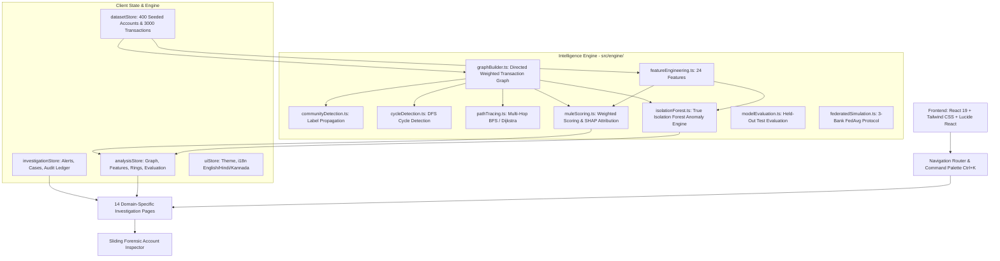

# MuleTrace AI — AI-Powered Mule Account Network Detector & Financial Intelligence Platform

> **Tagline:** Trace Suspicious Money. Uncover Hidden Networks. Protect Financial Systems.  
> **Course:** AI for Finance (CIA-2 Assignment) &bull; **Program:** B.Tech Artificial Intelligence & Machine Learning

[](https://www.typescriptlang.org/)
[](https://reactjs.org/)
[](https://vitejs.dev/)
[](https://js.cytoscape.org/)
[](https://vitest.dev/)
[](LICENSE)

---

## 1. Executive Summary & Problem Statement

Digital financial fraud across India's Unified Payments Interface (UPI) and Immediate Payment Service (IMPS) rails frequently relies on **money mule accounts**—bank accounts recruited or compromised to receive scam proceeds, rapidly layer them across intermediary nodes, and cash out before detection.

Traditional transaction-level monitoring examines payments in isolation (e.g. *flagging transfers above ₹50,000*). Cybercriminal syndicates easily evade these static thresholds through **structuring (smurfing)**, splitting large fraud proceeds into bursts of sub-threshold transfers (e.g. ₹49,200 or ₹9,850).

**MuleTrace AI** solves this limitation by evaluating the **complete transaction network**. By fusing graph topology metrics, unsupervised **Isolation Forest** anomaly detection, and explainable AI (XAI) feature attribution, MuleTrace AI uncovers coordinated mule rings, traces multi-hop layering paths to cash-out exit terminals, and identifies optimal freeze intervention points during the critical **Golden Hour**.

---

## 2. Core Technical Architecture & Technology Stack

MuleTrace AI is an **offline-first, zero-backend, client-side** forensic platform. All synthetic data generation, graph algorithms, machine learning models, and state management run directly in the browser in pure TypeScript.



### Technology Stack
- **Framework:** React 19, Vite 8, TypeScript (Strict Mode)
- **Styling & Design System:** Tailwind CSS (Forensic Midnight Navy & Cyber Teal visual aesthetic)
- **Interactive Graph Visualization:** Cytoscape.js (CoSE layout, dynamic sizing, animated money vectors)
- **Data Visualizations:** Recharts (Donut, Area, Horizontal Bar, Line charts)
- **State Management:** Zustand (Immutable decoupled stores)
- **CSV Handling:** PapaParse (Bi-directional CSV import/export with schema validation)
- **Icons:** Lucide React
- **Unit Testing:** Vitest (Pure TypeScript engine test suites)

---

## 3. Key Forensic Capabilities & Innovation Layer

### A. Core Detection Engine
1. **24 Feature Engineering Pipeline:** Computes in/out-degree, dwell time, pass-through ratio, income mismatch ratio, structuring frequency, night activity ratio, and cycle membership.
2. **True Isolation Forest Anomaly Detection:** Implements Liu et al.'s Isolation Forest in TypeScript with recursive random hyperplane splits, average path length $c(n)$, and normalized anomaly scores.
3. **Transparent Risk Fusion:** Combines $\text{Final Risk} = 0.6 \times \text{Behavior Score} + 0.4 \times \text{Isolation Forest Score}$ with customizable thresholds (Low: 0–34, Review: 35–65, High: 66–100).
4. **SHAP-Inspired Feature Attribution:** Every flagged account includes point-by-point feature contributions explaining *why* it was flagged and *what would lower the score*.
5. **False Positive Protection:** Incorporates business KYC mitigations (-30 pts) ensuring busy legitimate retail merchants are not wrongfully flagged.

### B. Innovative Differentiators
- **Golden Hour Clock:** Real-time countdown tracking recoverable money remaining before exit node dissipation.
- **Smart Freeze-Point Simulator:** Identifies the single upstream intermediary node where simulated intervention saves the highest downstream volume.
- **Scam Ring DNA Comparator:** Analyzes topological fingerprints across rings to uncover shared organizational modus operandi.
- **Safe-to-Pay Checker:** Consumer-facing UPI handle validator providing instant Safe/Caution/Risky ratings with 3 plain-language justifications.
- **Offline Analyst Copilot:** In-app natural language assistant that queries loaded memory graphs to answer forensic questions deterministically.
- **Adversarial Red-Team Simulator:** Tests how criminals attempting to lower risk scores (by delaying transfers) trade off against increased 1930 reporting risk.
- **Cross-Bank Federated Learning Simulation:** Simulates multi-bank parameter sharing across 3 virtual institutions (HDFC, SBI, ICICI) using the FedAvg protocol without exposing confidential customer data.
- **Cash-out Hotspots Map:** Vector SVG schematic map of Indian metropolitan corridors tracking ATM and crypto cash-out distributions without external map APIs.

---

## 4. Folder Structure

```text
trace_X/
├── index.html                   # HTML entry with forensic typography
├── package.json                 # Dependency manifests & scripts
├── vite.config.ts               # Vite bundler configuration
├── tailwind.config.js           # Forensic color palette & design tokens
├── postcss.config.js            # PostCSS configuration
├── tsconfig.json                # TypeScript project reference
├── src/
│   ├── main.tsx                 # Application mounting
│   ├── App.tsx                  # Root shell with layout, drawer, and page router
│   ├── index.css                # Base Tailwind & forensic scrollbar styling
│   ├── types/                   # Unified TypeScript interfaces
│   ├── data/
│   │   ├── seededRandom.ts      # Mulberry32 deterministic PRNG
│   │   ├── syntheticGenerator.ts# 400 accounts, 3000 txns, 6 planted rings
│   │   └── csvHandler.ts        # CSV validation, templates, and import/export
│   ├── engine/
│   │   ├── graphBuilder.ts      # Directed weighted transaction graph
│   │   ├── cycleDetection.ts    # Circular money flow detection
│   │   ├── communityDetection.ts# Label propagation clustering
│   │   ├── pathTracing.ts       # Multi-hop shortest paths & freeze points
│   │   ├── isolationForest.ts   # Pure TypeScript Isolation Forest
│   │   ├── muleScoring.ts       # Weighted scoring & SHAP attribution
│   │   ├── ringDetection.ts     # Syndicate extraction & Ring DNA
│   │   ├── modelEvaluation.ts   # Held-out test set evaluation & ROC
│   │   └── federatedSimulation.ts# 3-bank FedAvg learning simulation
│   ├── store/                   # Zustand state stores
│   ├── i18n/                    # Multilingual dictionary (English, Hindi, Kannada)
│   ├── components/              # Reusable UI & forensic widgets
│   ├── pages/                   # 14 distinct functional workspaces
│   └── tests/                   # Vitest unit test suites
├── README.md                    # Project overview & quickstart
├── REPORT.md                    # Comprehensive 23-section CIA-2 academic report
├── DEMO_SCRIPT.md               # 5-minute timed presentation walkthrough
├── AI_USAGE.md                  # AI transparency & design methodology
└── CHANGELOG.md                 # Development log & verification record
```

---

## 5. Quickstart & Installation

### Prerequisites
- Node.js `v18.0.0` or higher (Tested on `v24.16.0`)
- npm `v9.0.0` or higher (Tested on `v11.13.0`)

### Installation Commands
```bash
# 1. Clone repository or navigate to folder
cd trace_X

# 2. Install dependencies
npm install --legacy-peer-deps

# 3. Start local development server
npm run dev

# 4. Open in browser
# http://localhost:5173
```

### Build & Verification Commands
```bash
# Execute unit test suites (Vitest)
npm test

# Build production bundle
npm run build
```

---

## 6. Regulatory Context & Disclaimers

MuleTrace AI contextualizes real-world institutional initiatives:
- **India:** Reserve Bank Innovation Hub (**RBIH MuleHunter.AI**), Department of Telecommunications (**DoT FFRI & DIP**), Indian Cyber Crime Coordination Centre (**I4C Helpline 1930 & Suspect Registry**), and NPCI UPI Safety directives.
- **International:** South Korea (**ASAP**), United Kingdom (**Confirmation of Payee & Mandatory APP Reimbursement**), Singapore (**Shared Responsibility Framework**), and Australia (**Scam-Safe Accord**).

> [!IMPORTANT]
> **Ethical & Academic Prototype Disclaimer:** MuleTrace AI is an educational student research prototype operating exclusively on synthetic data. It is not connected to core banking systems, does not execute live account freezes, and does not assert criminal culpability against real individuals. All simulated enforcement actions require independent human investigation.
